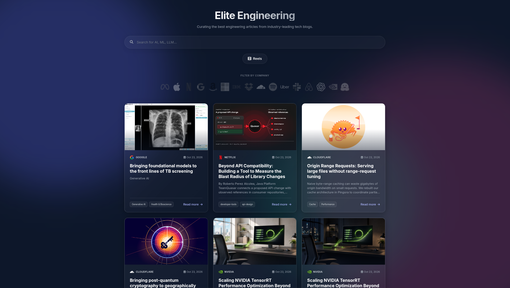

> Curating the best engineering articles from industry-leading tech blogs.

**Elite Engineering** is an aggregator of news and articles covering software engineering, system architecture, and infrastructure. It consumes-in real time-the official RSS/Atom feeds from the world's leading technology companies (such as Meta, Apple, Cloudflare, Dropbox, and GitHub), centralizing high-level technical knowledge within a single, modern, and responsive interface.

## How it works

```
browser ──▶ web/ (Cloudflare Pages, static)
   │
   └──▶ GET /api/feed?url=<feed> ──▶ api/ (Cloudflare Worker) ──▶ company blog
   ◀──────────── raw RSS/Atom XML ◀─────────┘
```

- **`web/`** is the front end: plain HTML, CSS and ES modules, no build step. It parses RSS 2.0 and Atom in the browser (`src/services/FeedProxyProvider.js`) and caches the articles in `localStorage` for 12 hours.
- **`api/`** is a Worker that fetches the feeds on the browser's behalf, since blogs don't allow cross-origin requests. It only proxies the feeds listed in `web/data/companies.js`, caches them at the edge for 30 minutes, rejects requests from other origins, and logs every request with [pino](https://getpino.io).
- **`web/config.js`** picks the API URL: `http://localhost:8787` when running locally, `https://elite-engineering-api.williamtrindade-dev.workers.dev` otherwise.

## Project structure

```
web/                 front end (Cloudflare Pages)
  data/companies.js  companies and feed URLs (also the API's allowlist)
  config.js          API base URL
api/                 feed proxy (Cloudflare Worker)
  src/index.js       request handler, allowlist, CORS
  wrangler.jsonc     Worker config
test/                parser and API tests
```

## Running locally

Requires Node.js 22+.

```bash
npm install
npm --prefix api install
npm run dev
```

Open **http://localhost:8788**. `npm run dev` starts both servers:

| Script | What it runs | URL |
|---|---|---|
| `npm run dev:api` | `wrangler dev` (Worker runtime) | http://localhost:8787 |
| `npm run dev:web` | `serve` (static files) | http://localhost:8788 |

Opening `web/index.html` directly from disk does not work: browsers block ES modules on `file://`.

To fetch the feeds again instead of reading the 12-hour cache, clear the site's `localStorage` (DevTools → Application → Clear site data).

The API only answers requests from the site's origins (production, preview deployments and localhost), and returns `403` otherwise. To call it with curl, send the header:

```bash
curl -H "Origin: http://localhost:8788" "http://localhost:8787/api/feed?url=https%3A%2F%2Fblog.cloudflare.com%2Frss%2F"
```

This keeps other websites from using the API through their visitors' browsers. It is not authentication: a script can fake the `Origin` header.

Each IP is also limited to 60 requests per minute (`ratelimits` in `api/wrangler.jsonc`); above that the API returns `429` with `Retry-After: 60`. A full page load without cache makes 15 requests, one per feed.

## Tests

```bash
npm test
```

Runs the feed parser tests against real RSS/Atom fixtures (`test/fixtures/`) and the Worker handler tests (allowlist, CORS, error responses), with no network access.

## Adding a company or feed

Add it to `web/data/companies.js` and its logo to `web/static/`. The API allowlist is built from the same file, so no API change is needed. Both projects must be deployed for the new feed to load.

For feeds that mix engineering posts with everything else, a feed can keep only some categories and cap the number of items:

```js
new Feed({ url: 'https://openai.com/news/rss.xml', categories: ['Engineering', 'Research', 'Security'], limit: 30 })
```

Categories match case-insensitively; items without a matching category are dropped.

## Deployment

Front end and API are two Cloudflare projects connected to this repository, each deployed on push:

| | Pages (`web`) | Worker (`api`) |
|---|---|---|
| Root directory | `web` | `api` |
| Build command | *(empty)* | *(empty, or `npm ci` if dependencies aren't installed)* |
| Deploy command | — | `npx wrangler deploy` |
| Output directory | `.` | — |

Worker logs are in **Workers & Pages → elite-engineering-api → Logs** (Workers Logs is enabled in `wrangler.jsonc`).
