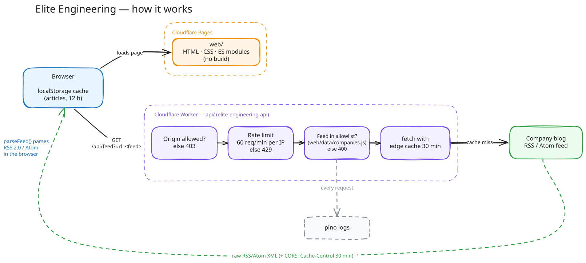
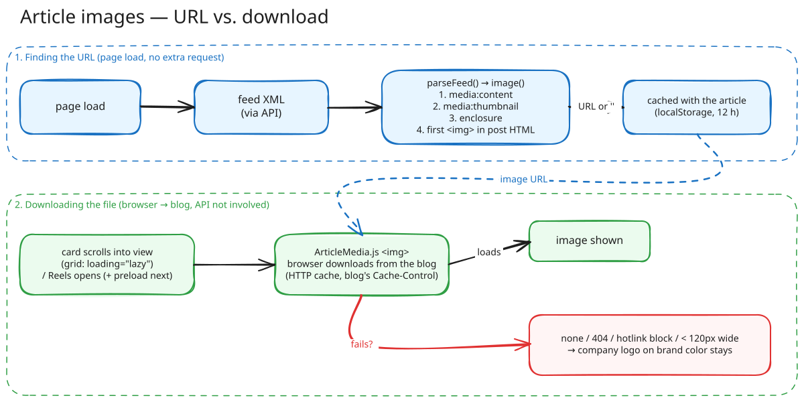
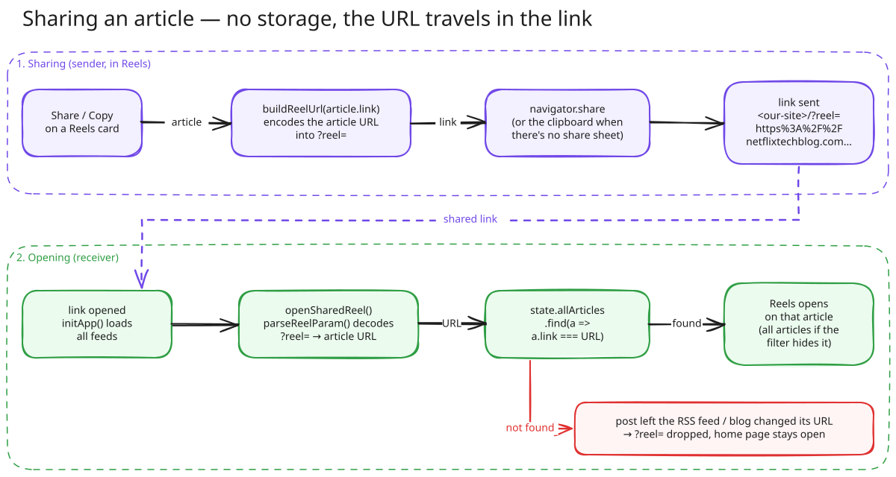

> Curating the best engineering articles from industry-leading tech blogs.

**Elite Engineering** is an aggregator of news and articles covering software engineering, system architecture, and infrastructure. It consumes-in real time-the official RSS/Atom feeds from the world's leading technology companies (such as Meta, Apple, Cloudflare, Dropbox, and GitHub), centralizing high-level technical knowledge within a single, modern, and responsive interface.

## How it works



- **`web/`** is the front end: plain HTML, CSS and ES modules, no build step. It parses RSS 2.0 and Atom in the browser (`src/adapters/feedParser.js`) and caches the articles in `localStorage` for 12 hours.
- **`api/`** fetches the feeds on the browser's behalf, since blogs don't allow cross-origin requests. It only proxies the feeds listed in `web/data/companies.js`, caches them for 30 minutes, rejects requests from other origins, rate limits each IP, and logs every request with [pino](https://getpino.io). Its core is platform-independent: in production it runs as a Cloudflare Worker, locally as a plain Node server (see [Architecture](#architecture)).
- **`web/config.js`** picks the API URL: `http://localhost:8787` when running locally, `https://elite-engineering-api.williamtrindade-dev.workers.dev` otherwise.

## Article images

Images are handled in two separate steps: finding the image's URL, then downloading the file.

**1. Finding the URL: inside the feed XML, when the feed is parsed.** No extra request is made: the URL comes in the same XML the API already returns. `image()` in `src/adapters/feedParser.js` looks, in this order, for:

| # | Where in the item | Example feeds |
|---|---|---|
| 1 | `<media:content medium="image" url="…">` | Google Research, Dropbox |
| 2 | `<media:thumbnail url="…">` | Google Research, Dropbox |
| 3 | `<enclosure type="image/…" url="…">` (or an Atom `<link rel="enclosure">`) | Cloudflare |
| 4 | first `` in the post HTML (`content:encoded`/`description`, or Atom `content`/`summary`) | Meta, Netflix, AWS, NVIDIA, Slack… |

Step 4 skips `data:` placeholders and images declared smaller than 50px (icons, Medium's 1×1 tracking pixel). The URL is then resolved against the article link (relative paths), upgraded from `http` to `https`, and dropped if it uses any other scheme. If nothing is found, `image` is `''`. Some feeds (OpenAI, Hugging Face, Spotify, Apple ML, Google Developers) have no images at all.

The URL is stored with the rest of the article, so it is cached in `localStorage` for 12 hours like everything else.

**2. Downloading the file: by the browser, straight from the blog's server, when the card is about to be seen.** The API is not involved. `src/ui/ArticleMedia.js` creates the ``:

- in the grid with `loading="lazy"`: the browser only downloads images of cards near the viewport;
- in Reels right away, plus the next card's image in the background (`preloadImage`) so a swipe shows it immediately.

Downloaded files go to the browser's normal HTTP cache, for as long as each blog's `Cache-Control` allows (from 0 for Cloudflare up to a year for Meta). They are not stored in `localStorage`: a few images would exceed its ~5 MB limit.

While an image loads, or when there is none, or it fails (404, hotlink blocking, an image under 120px wide), the card shows the company logo on its brand color.



---

## Sharing an article

The **Share** and **Copy** buttons in Reels send a link to our site, not to the blog, so whoever opens it sees the article in our Reels. Nothing is stored: the article's URL travels inside the link.

1. **Share:** the article URL is encoded into the `reel` query param (`buildReelUrl()` in `src/ui/ShareLink.js`):
   `https://<our-site>/?reel=https%3A%2F%2Fnetflixtechblog.com%2Fbeyond-api-compatibility-...`
2. **Open:** after the feeds load, `openSharedReel()` in `src/main.js` decodes the param (`parseReelParam()`) back into the article URL.
3. **Find:** it looks for the article with that exact `link` in `state.allArticles`.
4. **Show:** if found, Reels opens on it (browsing all articles if the active filter would hide it). If not (the post left the RSS feed, or the blog changed its URL), the param is dropped and the home page stays open.

While browsing Reels, the address bar is kept on the current article's link, so it can be copied from there too; closing Reels removes the param.



--- 

## Architecture

API and front end follow **hexagonal architecture** (ports and adapters): a **core** with the app's rules, which depends only on **ports** (interfaces), and **adapters** that implement them for a given technology (Cloudflare, `fetch`, `localStorage`, pino). Adapters are plugged in by a **composition root**, the only code that knows which implementation is in use. Design notes: [`docs/superpowers/specs/2026-10-25-hexagonal-architecture-design.md`](docs/superpowers/specs/2026-10-25-hexagonal-architecture-design.md). Diagram: [`docs/diag/hexagonalArchitecture.excalidraw`](docs/diag/hexagonalArchitecture.excalidraw).

```
composition root  ──plugs──▶  adapters  ──implement──▶  ports  ◀──uses──  core
(main.js, platforms/)        (fetch, memory, Cloudflare, UI)    (JSDoc)          (rules)
```

**The one rule:** the core never imports adapters, UI or platforms. `test/architecture.test.js` enforces it on every `npm test`. Ports are JSDoc `@typedef`s, so there is no build step; ports with several implementations have a **contract suite** in `test/api/contracts/` that every implementation must pass.

### API

```
api/
  src/
    app.js        core: Origin, CORS, routing, rate limit, allowlist, proxy
                  createApi({ config, rateLimiter, feedGateway, logger, clientIp })
    ports.js      RateLimiter, FeedGateway, Logger, ClientIp
    adapters.js   FetchFeedGateway, CachedFeedGateway, MemoryCache, MemoryRateLimiter
    config.js     parseConfig(env): the only reader of environment variables
  platforms/      one per runtime: builds the adapters and serves createApi
    node.js       node:http server + memory adapters (npm run dev)
    cloudflare/   worker.js (with CfRateLimiter), wrangler.jsonc, its own package.json
```

The core only uses web-standard `Request`/`Response`, so the same `app.js` runs on Node and Workers:

| | Node (`api/platforms/node.js`) | Cloudflare (`api/platforms/cloudflare/`) |
|---|---|---|
| Config | `.env` (`node --env-file-if-exists=.env`) | `vars` in `wrangler.jsonc` |
| Rate limit | `MemoryRateLimiter` | `CfRateLimiter` over the `FEED_LIMITER` binding |
| Feed cache | `CachedFeedGateway` + `MemoryCache` | edge cache (`fetch` with `cf.cacheTtl`) |
| Client IP | socket address | `CF-Connecting-IP` |

**Cloudflare is a plugin.** Wrangler and every Cloudflare API live in `api/platforms/cloudflare/`; the rest of the project doesn't install or mention them (a test checks it). Deleting that folder leaves `npm install`, `npm run dev` and `npm test` working.

**Plugging something in:** to swap an implementation (say, a Redis rate limiter), write a class with the port's shape (in `adapters.js`, or in a platform folder if it's platform-specific), run the contract suite against it, and change one line in the platform. To run on another platform, add `api/platforms/<name>` that builds the adapters and calls `createApi`.

### Front end

```
web/
  config.js          API URL per environment (imported only by src/main.js)
  data/companies.js  companies and feed URLs (also the API's allowlist)
  src/
    core/            Article, Company, Feed, filterArticles (company filter + search),
                     LoadArticles (every feed → Articles, newest first; a broken feed is skipped)
    ports.js         FeedGateway, KeyValueStore
    adapters/        ApiFeedGateway (API + parser), CachedFeedGateway (12 h), LocalStorageStore, feedParser
    ui/              UI, ReelsUI, ArticleMedia, Theme, ShareLink, AppController, screen state
    main.js          composition root
```

`core/` imports only itself and `ports.js`; `adapters/` and `ui/` use the core but not each other.

---

## Configuration

Every environment setting is a variable, validated at startup by `api/src/config.js`; a missing or invalid one stops the API with a message naming it. `.env.example` documents each key:

| Key | Default | What it does |
|---|---|---|
| `PORT` | `8787` | Node server port (Node only) |
| `ALLOWED_ORIGINS` | required | Comma-separated origins allowed to call the API. `*.` at the start of the host matches one subdomain label (preview deployments); `:*` matches any port |
| `FEED_CACHE_SECONDS` | required | How long a feed is reused, and the `Cache-Control` sent to browsers |
| `RATE_LIMIT_REQUESTS` | required | Requests per IP in each period |
| `RATE_LIMIT_PERIOD_SECONDS` | required | Length of that period; also the `Retry-After` of a `429` |
| `LOG_LEVEL` | `info` | pino level |

- **Node:** `.env`, created from `.env.example` on the first `npm run dev`. It is git-ignored, so each clone has its own.
- **Cloudflare:** the same keys are in `vars` in `api/platforms/cloudflare/wrangler.jsonc`. The rate limit binding can't read variables, so its `limit`/`period` are written in `ratelimits` too; a test fails if they differ from the vars. Secrets (future database or login keys) go in the dashboard or `wrangler secret put`, never in the repository.
- **Front end:** it's static and public, so it has no `.env`. Its only setting is the API URL in `web/config.js`.

---

## Running locally

Requires Node.js 22+. No Cloudflare account or wrangler needed.

```bash
npm install
npm run dev
```

The first `npm run dev` creates `.env` from `.env.example` if it doesn't exist; edit it to change ports, origins or limits.

Open **http://localhost:8788**. `npm run dev` starts both servers:

| Script | What it runs | URL |
|---|---|---|
| `npm run dev:api` | `api/platforms/node.js` (restarts on change) | http://localhost:8787 |
| `npm run dev:web` | `serve` (static files) | http://localhost:8788 |

To test something Cloudflare-specific (the rate limit binding, the edge cache), run the Worker runtime instead of `dev:api`:

```bash
npm --prefix api/platforms/cloudflare install
npm --prefix api/platforms/cloudflare run dev
```

Opening `web/index.html` directly from disk does not work: browsers block ES modules on `file://`.

To fetch the feeds again instead of reading the 12-hour cache, clear the site's `localStorage` (DevTools → Application → Clear site data).

The API only answers requests from `ALLOWED_ORIGINS`, and returns `403` otherwise. To call it with curl, send the header:

```bash
curl -H "Origin: http://localhost:8788" "http://localhost:8787/api/feed?url=https%3A%2F%2Fblog.cloudflare.com%2Frss%2F"
```

This keeps other websites from using the API through their visitors' browsers. It is not authentication: a script can fake the `Origin` header.

Each IP is also limited to `RATE_LIMIT_REQUESTS` per `RATE_LIMIT_PERIOD_SECONDS` (60 per minute); above that the API returns `429` with `Retry-After`. A full page load without cache makes one request per feed.

--- 

## Tests

```bash
npm test
```

No network access and no wrangler. It runs:

| Where | What |
|---|---|
| `test/api/app.test.js` | the API behaviour (Origin and its wildcards, CORS, allowlist, rate limit, 4xx/5xx) through `createApi` with test adapters |
| `test/api/config.test.js` | environment validation, `.env.example` complete |
| `test/api/adapters.test.js` + `contracts/` | each adapter against its port's contract suite |
| `test/api/node.test.js` | the Node platform with a real server |
| `api/platforms/cloudflare/test/` | the Worker with a fake binding; `wrangler.jsonc` checks. Lives in the platform folder, so it goes away with it |
| `test/web/` | feed parser (real RSS/Atom fixtures), search, share links, `LoadArticles`, the feed cache |
| `test/architecture.test.js` | the core doesn't depend on adapters, and Cloudflare stays in its folder |

## Adding a company or feed

Add it to `web/data/companies.js` and its logo to `web/static/`. The API allowlist is built from the same file, so no API change is needed. Both projects must be deployed for the new feed to load.

For feeds that mix engineering posts with everything else, a feed can keep only some categories and cap the number of items:

```js
new Feed({ url: 'https://openai.com/news/rss.xml', categories: ['Engineering', 'Research', 'Security'], limit: 30 })
```

Categories match case-insensitively; items without a matching category are dropped.

--- 

## Deployment

Front end and API are two Cloudflare projects connected to this repository, each deployed on push:

| | Pages (`web`) | Worker (`api`) |
|---|---|---|
| Root directory | `web` | `api/platforms/cloudflare` |
| Build command | *(empty)* | *(empty, or `npm ci` if dependencies aren't installed)* |
| Deploy command | — | `npx wrangler deploy` |
| Output directory | `.` | — |

The Worker's root directory is its platform folder, so the build installs wrangler there and nowhere else. `wrangler.jsonc` points `main` at `worker.js`, which imports the core from `api/src/`.

Worker logs are in **Workers & Pages → elite-engineering-api → Logs** (Workers Logs is enabled in `wrangler.jsonc`).

## Known issues

- The **Try Again** button on the error screen calls `initApp()` from an inline `onclick`, but `initApp` lives inside the `src/main.js` module, so it isn't reachable from there. Reloading the page works.
