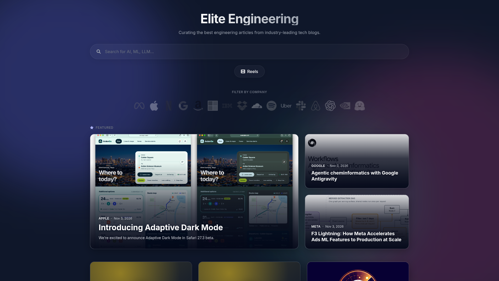
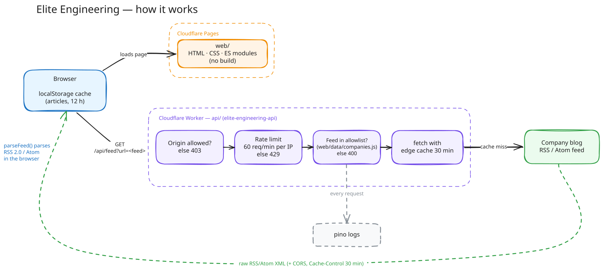
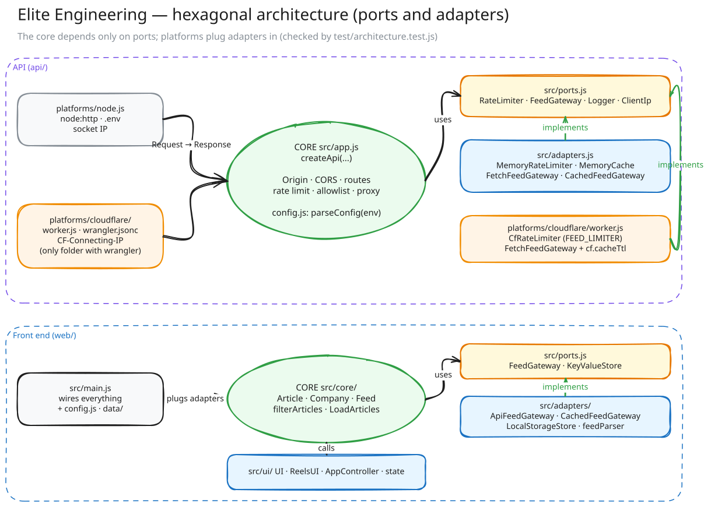
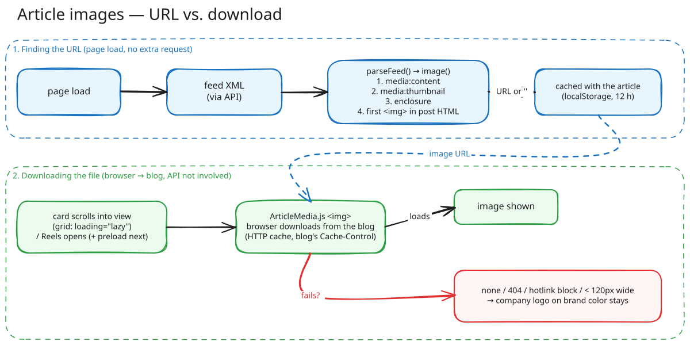
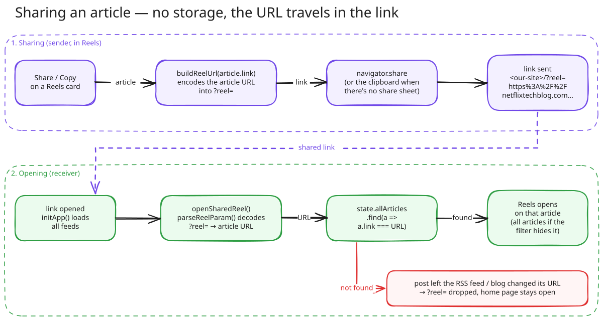

> Curating the best engineering articles from industry-leading tech blogs.

**Elite Engineering** aggregates the official RSS/Atom feeds of 33 top tech companies (Meta, Apple, Google, Netflix, GitHub, Shopify, Datadog, Nubank…) into one fast, responsive page.

- [Quick start](#quick-start) · [Commands](#commands) · [How it works](#how-it-works) · [Project structure](#project-structure) · [Configuration](#configuration)
- [Common tasks](#common-tasks) · [Tests](#tests) · [Deployment](#deployment) · [Reference](#reference) ([sponsored slots](#sponsored-slots)) · [Known issues](#known-issues)

## Quick start

Requires Node.js 22+. No Cloudflare account needed.

```bash
npm install
npm run dev        # creates .env from .env.example the first time
```

Open **http://localhost:8788**.

## Commands

| Command | What it does |
|---|---|
| `npm run dev` | API (http://localhost:8787) + front end (http://localhost:8788) |
| `npm run dev:api` | only the API, on Node; restarts on change |
| `npm run dev:web` | only the front end (static files) |
| `npm test` | all tests, no network |
| `npm --prefix api/platforms/cloudflare run dev` | the API on the real Worker runtime (needs `npm --prefix api/platforms/cloudflare install` once) |

## How it works



- **`web/`**: front end in plain HTML, CSS and ES modules, with no build step. It parses the feeds in the browser and caches the articles in `localStorage` for **12 h**. It waits for the feeds for at most **3 s** and then shows what arrived: a slower feed is left out of that visit, keeps loading in the background, and shows up on the next one from the cache. The page never reorders itself after it shows. A shared Reels link (`?reel=`) waits for every feed instead, since the article may be in a slow one. It gives up on a feed the API doesn't answer within **10 s**.
- **`api/`**: fetches the feeds for the browser, because blogs block cross-origin requests. It only serves feeds listed in `web/data/companies.js`, caches them for **30 min**, accepts only the site's origins, and allows **120 requests/min per IP** (an uncached page load makes one per feed). A blog that doesn't answer within **8 s** gets a `502`, so it can't hold the request. It runs on Cloudflare Workers in production and on Node locally.
- **Images** are not proxied: the browser downloads them straight from each blog ([details](#article-images)).

## Project structure

The code follows **hexagonal architecture**: each side has a **core** with the rules, **ports** (interfaces) that the core depends on, and **adapters** that implement them. See [Architecture](#architecture).

```
api/
  src/
    app.js            core: Origin, CORS, routes, rate limit, allowlist, proxy
    ports.js          interfaces: RateLimiter, FeedGateway, Logger, ClientIp
    adapters.js       fetch, in-memory cache and rate limiter
    config.js         reads and validates the environment variables
  platforms/
    node.js           Node server (npm run dev)
    cloudflare/       Worker + wrangler.jsonc; the only folder that uses wrangler
web/
  index.html, style.css, static/
  config.js           API URL per environment
  data/companies.js   companies and feeds (also the API's allowlist)
  data/sponsors.js    sponsors and the advertiser contact
  advertise.html      page for advertisers (/advertise)
  src/
    core/             Article, Company, Feed, filterArticles, pickFeatured, sponsorSlots, LoadArticles
    ports.js          interfaces: FeedGateway, KeyValueStore
    adapters/         API client, feed parser, localStorage cache
    ui/               grid, Featured section, sponsor cards, Reels, share links, screen state
    main.js           wires adapters into the core
test/                 api/, web/, architecture.test.js
docs/                 diagrams (docs/diag) and design notes (docs/superpowers/specs)
agents.md             rules for AI coding agents working on this repository
```

## Configuration

All settings are environment variables, validated by `api/src/config.js` at startup. A missing or invalid one stops the API with a message naming it.

| Key | Default | What it does |
|---|---|---|
| `PORT` | `8787` | Node server port (Node only) |
| `ALLOWED_ORIGINS` | required | Origins allowed to call the API, comma-separated. `https://*.site.dev` matches one subdomain; `http://localhost:*` matches any port |
| `FEED_CACHE_SECONDS` | required | How long a feed is reused, also sent as `Cache-Control` |
| `RATE_LIMIT_REQUESTS` | required | Requests per IP per period |
| `RATE_LIMIT_PERIOD_SECONDS` | required | Period length, also the `Retry-After` of a `429` |
| `LOG_LEVEL` | `info` | pino log level |

| Where | Settings come from |
|---|---|
| Node (local) | `.env`, git-ignored and created from `.env.example` by `npm run dev` |
| Cloudflare | `vars` in `api/platforms/cloudflare/wrangler.jsonc`. The rate limit numbers are repeated in `ratelimits` (the binding can't read vars), and a test checks that both match |
| Front end | `web/config.js` only (the front end is public, so it holds no secrets) |

Secrets (a database or login key, later on) never go in the repository: use `.env` locally and `npx wrangler secret put NAME` (or the dashboard) on Cloudflare.

## Common tasks

**Add a company or feed:** add it to `web/data/companies.js` and its logo to `web/static/`. The API allowlist reads the same file. Deploy both projects. For feeds that mix topics, filter by category and cap the number of items:

```js
new Feed({ url: 'https://openai.com/news/rss.xml', categories: ['Engineering', 'Research', 'Security'], limit: 30 })
```

If the blog blocks its images on other sites (the browser logs `ERR_BLOCKED_BY_RESPONSE`), add `images: false` so its cards use the logo instead (AMD's GPUOpen does this). Logos are 256×256 `.webp` with a transparent background; [Simple Icons](https://simpleicons.org) has most brands as SVG, in their brand color. Each page load without cache makes one API request per feed, so keep `RATE_LIMIT_REQUESTS` well above the number of feeds.

**Featured section:** above the grid, the 3 newest articles with a cover image, at most one per company (`web/src/core/pickFeatured.js`). It shows only on the home view (no company filter, no search), and those articles are left out of the grid below; Reels still goes through every article. Change `count` there to show more or fewer.

**Add a sponsor:** add it to `sponsors` in `web/data/sponsors.js` (fields documented there and in `web/src/core/sponsorSlots.js`). Where slots go, how many and which sponsor fills each one: [Sponsored slots](#sponsored-slots). With no sponsors, an "Advertise here" card (→ `/advertise`) fills the same slots. Links get `rel="sponsored"` and UTM tags (`utm_source=elite-engineering`, `utm_content=grid|reels`). Before deploying, set `ADVERTISE_CONTACT` there and the matching `data-advertise-contact` links in `web/advertise.html` (a test checks they match).

**Keep SEO in sync:** the static parts crawlers read live in `web/` and point to `https://elite-engineering.pages.dev/`: the `<head>` of `index.html` (description, canonical, Open Graph, `WebSite` JSON-LD), the `#about` footer, `robots.txt`, `sitemap.xml` and `static/og-image.jpg` (1200×630). When you add a company, name it in `#about` too (`test/web/seo.test.js` fails otherwise). If the domain changes, update every one of those URLs. Search links (`/?q=<query>`) open with the search applied; they are the JSON-LD `SearchAction` target.

**Call the API by hand:** it answers only the allowed origins (`403` otherwise), so send the header:

```bash
curl -H "Origin: http://localhost:8788" "http://localhost:8787/api/feed?url=https%3A%2F%2Fblog.cloudflare.com%2Frss%2F"
```

The Origin check stops other websites, but it is not authentication: a script can fake the header.

**Change the waiting times:** they are constants, not environment variables. How long the page waits before showing what arrived: `WAIT_MS` in `web/src/core/LoadArticles.js` (3 s; `Infinity` waits for every feed, used for `?reel=` links). How long the browser waits for the API: `FEED_TIMEOUT_MS` in `web/src/adapters/ApiFeedGateway.js` (10 s). How long the API waits for a blog: `FEED_TIMEOUT_MS` in `api/src/adapters.js` (8 s). Keep the browser's above the API's, so the API answers with a `502` first.

**Reload the feeds instead of using the 12 h cache:** DevTools → Application → Clear site data.

**Swap an implementation** (e.g. a Redis rate limiter): write a class with the port's shape, run the port's contract suite (`test/api/contracts/`) against it, then change one line in `api/platforms/node.js` or `api/platforms/cloudflare/worker.js`.

**Run on another platform:** add `api/platforms/<name>` that builds the adapters and calls `createApi()` from `api/src/app.js`.

Opening `web/index.html` from disk doesn't work, because browsers block ES modules on `file://`. Use `npm run dev`.

## Tests

```bash
npm test
```

| Where | What |
|---|---|
| `test/api/app.test.js` | API behaviour: origins, CORS, allowlist, rate limit, errors |
| `test/api/config.test.js` | environment validation |
| `test/api/adapters.test.js`, `contracts/` | each adapter against its port's contract, and the timeout on a blog that never answers |
| `test/api/node.test.js` | Node server |
| `api/platforms/cloudflare/test/` | Worker wiring and `wrangler.jsonc` checks (removed along with the folder) |
| `test/web/` | feed parser (real RSS/Atom fixtures), search, Featured picks, sponsor slots and the advertise page, Reels gestures (drag, wheel), share and search links, article loading (the 3 s wait, and waiting for every feed) and cache, the API client's timeout, SEO tags |
| `test/architecture.test.js` | the core doesn't import adapters, and Cloudflare code stays in its folder |

## Deployment

Two Cloudflare projects connected to this repository, each deployed on push:

| | Pages (front end) | Worker (API) |
|---|---|---|
| Project | `elite-engineering` | `elite-engineering-api` |
| Root directory | `web` | `api/platforms/cloudflare` |
| Build command | *(empty)* | *(empty)* |
| Deploy command | — | `npx wrangler deploy` |
| Output directory | `.` | — |

To change them: **Workers & Pages → project → Settings → Build**. The API's settings travel with the code in `wrangler.jsonc`, so a deploy needs no manual keys.

Manual Worker deploy: `npm --prefix api/platforms/cloudflare run deploy` (after `npx wrangler login`).

Logs: **Workers & Pages → elite-engineering-api → Logs**.

## Reference

### Architecture



- **One rule:** the core (`api/src/app.js`, `web/src/core/`) never imports adapters, UI or platforms. `test/architecture.test.js` enforces it.
- **Ports** are JSDoc `@typedef`s, so there is no build step. Each port with several implementations has a contract suite that every implementation must pass.
- **Composition roots** (`api/platforms/*`, `web/src/main.js`) are the only code that picks implementations.
- **Cloudflare is a plugin:** deleting `api/platforms/cloudflare/` leaves `npm install`, `npm run dev` and `npm test` working.

| | Node | Cloudflare |
|---|---|---|
| Rate limit | in memory | Workers Rate Limiting binding (`FEED_LIMITER`) |
| Feed cache | in memory | Cloudflare edge cache |
| Client IP | socket address | `CF-Connecting-IP` |

Design notes and decisions: [`docs/superpowers/specs/2026-10-25-hexagonal-architecture-design.md`](docs/superpowers/specs/2026-10-25-hexagonal-architecture-design.md). Diagram source: [`docs/diag/hexagonalArchitecture.excalidraw`](docs/diag/hexagonalArchitecture.excalidraw).

### Article images



1. **Finding the URL** happens inside the feed XML, while parsing, with no extra request. `image()` in `web/src/adapters/feedParser.js` tries, in order:
   1. `<media:content medium="image">` (Google Research, Dropbox)
   2. `<media:thumbnail>`
   3. `<enclosure type="image/…">` or Atom `<link rel="enclosure">` (Cloudflare)
   4. the first `` in the post HTML (Meta, Netflix, AWS, NVIDIA, Slack…), skipping `data:` URLs and images smaller than 50px

   The URL is made absolute and upgraded to `https`. Some feeds have no images (OpenAI, Hugging Face, Spotify, Apple ML, Google Developers, Shopify, Yelp, Datadog), and AMD's are dropped on purpose (`images: false`, see [Common tasks](#common-tasks)).
2. **Downloading the file** is done by the browser, straight from the blog, without the API. In the grid it uses `loading="lazy"`; in Reels it loads right away and preloads the next card. Caching follows each blog's `Cache-Control`. Files are not stored in `localStorage`, whose ~5 MB limit a few images would exceed.
3. **Fallback:** while loading, or when there is no image or it fails (404, hotlink block, narrower than 120px), the card shows the company logo on its brand color.

### Sharing an article



Reels' **Share** and **Copy** buttons link to our site, not the blog, so the link opens in our Reels. Nothing is stored: the article URL travels in the link.

1. `buildReelUrl()` (`web/src/ui/ShareLink.js`) puts the article URL in `?reel=`.
2. On load, `openSharedReel()` (`web/src/main.js`) reads it back and looks for the article with that exact `link`.
   With `?reel=` the page skips the 3 s wait and loads every feed first (`web/src/main.js`), so an article from a slow blog is still found. A blog that hangs delays it up to the timeouts (8 s in the API, 10 s in the browser).
3. If it finds the article, Reels opens on it. If not (the post left the feed, the URL changed, or its blog didn't answer in time), the param is dropped and the home page stays.

While browsing Reels, the address bar shows the current article's link; closing Reels removes it.

### Sponsored slots

**The rule: one ad after every 8 articles, in the grid and in Reels.** It's one function, `placeSponsors()` in `web/src/core/sponsorSlots.js`, and one number, `AD_EVERY = 8` in `web/src/ui/state.js`.

```
a1 … a8 [AD] a9 … a16 [AD] a17 … a24 [AD] …
```

**How many:** with `n` articles in the list,

```
ads = floor((n − 1) / 8)
```

The `− 1` keeps an ad from ending the list: there's always an article after it. A list of up to 8 articles has no ads.

| Articles in the list | Ads |
|---|---|
| 8 | 0 |
| 9 | 1 |
| 17 | 2 |
| 50 | 6 |
| 100 | 12 |
| 226 (a typical home view) | 28 |

**Which list:** the one the reader sees, after the company filter and the search. In the grid, that's without the 3 Featured articles (on the home view); in Reels, it's all of them, newest first. Ads never go in the Featured section.

**Which ad goes in each slot:**

- Sponsors whose `placements` include that list (`'grid'` or `'reels'`) take turns, in the order of `web/data/sponsors.js`. With 3 sponsors and 28 slots, each one shows 9 or 10 times.
- With no sponsors, the house ad ("Advertise here" → `/advertise`) fills the same slots.

**Label and link:** every ad shows a **Sponsored** badge. Sponsor links open in a new tab with `rel="sponsored noopener"` and UTM tags (`utm_source=elite-engineering`, `utm_medium=sponsored`, `utm_content=grid|reels`). In Reels, the counter shows "Sponsored" and the address bar drops `?reel=`, since ads can't be shared.

**To change it:** set `AD_EVERY` (a larger number means fewer ads). Limits per sponsor aren't implemented; they would go in `placeSponsors()`, with a test in `test/web/sponsorSlots.test.js`.

## Known issues

- **Try Again** on the error screen does nothing: its inline `onclick="initApp()"` can't reach a function inside the `src/main.js` module. Reload the page instead.
- Uber has no RSS of its own, so its feed comes from a public [RSSHub](https://docs.rsshub.app) instance (`hub.slarker.me`). Public instances come and go (`rsshub.app` started answering `403`), and this one sometimes hangs: the API gives up after 8 s and the page doesn't wait for it, so Uber is just missing on that visit. If Uber keeps showing no articles, swap the host in `web/data/companies.js` for another instance, e.g. `rsshub.ktachibana.party`, or self-host RSSHub.
