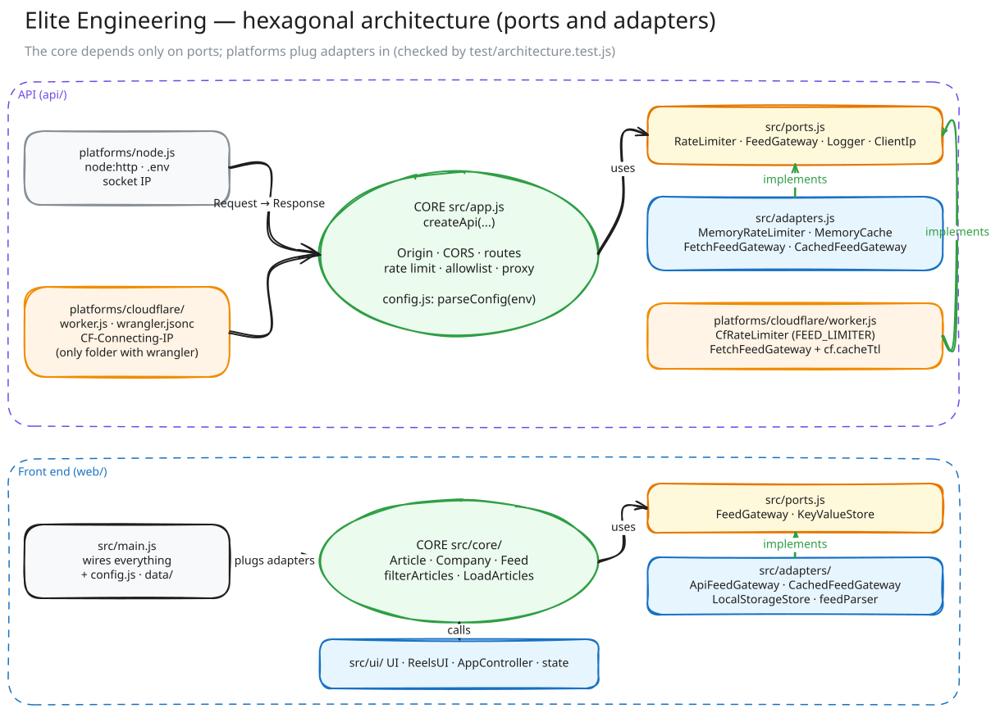

> Curating the best engineering articles from industry-leading tech blogs.

**Elite Engineering** aggregates the official RSS/Atom feeds of top tech companies (Meta, Apple, Cloudflare, Dropbox, GitHub…) into one fast, responsive page.

- [Quick start](#quick-start) · [Commands](#commands) · [How it works](#how-it-works) · [Project structure](#project-structure) · [Configuration](#configuration)
- [Common tasks](#common-tasks) · [Tests](#tests) · [Deployment](#deployment) · [Reference](#reference) · [Known issues](#known-issues)

## Quick start

Requires Node.js 22+. No Cloudflare account needed.

```bash
npm install
npm run dev        # creates .env from .env.example the first time
```

Open **http://localhost:8788**.

## Commands

| Command | What it does |
|---|---|
| `npm run dev` | API (http://localhost:8787) + front end (http://localhost:8788) |
| `npm run dev:api` | only the API, on Node; restarts on change |
| `npm run dev:web` | only the front end (static files) |
| `npm test` | all tests, no network |
| `npm --prefix api/platforms/cloudflare run dev` | the API on the real Worker runtime (needs `npm --prefix api/platforms/cloudflare install` once) |

## How it works


- **`web/`**: front end in plain HTML, CSS and ES modules, with no build step. It parses the feeds in the browser and caches the articles in `localStorage` for **12 h**.
- **`api/`**: fetches the feeds for the browser, because blogs block cross-origin requests. It only serves feeds listed in `web/data/companies.js`, caches them for **30 min**, accepts only the site's origins, and allows **60 requests/min per IP**. It runs on Cloudflare Workers in production and on Node locally.
- **Images** are not proxied: the browser downloads them straight from each blog ([details](#article-images)).

## Project structure

The code follows **hexagonal architecture**: each side has a **core** with the rules, **ports** (interfaces) that the core depends on, and **adapters** that implement them. See [Architecture](#architecture).

```
api/
  src/
    app.js            core: Origin, CORS, routes, rate limit, allowlist, proxy
    ports.js          interfaces: RateLimiter, FeedGateway, Logger, ClientIp
    adapters.js       fetch, in-memory cache and rate limiter
    config.js         reads and validates the environment variables
  platforms/
    node.js           Node server (npm run dev)
    cloudflare/       Worker + wrangler.jsonc; the only folder that uses wrangler
web/
  index.html, style.css, static/
  config.js           API URL per environment
  data/companies.js   companies and feeds (also the API's allowlist)
  src/
    core/             Article, Company, Feed, filterArticles, LoadArticles
    ports.js          interfaces: FeedGateway, KeyValueStore
    adapters/         API client, feed parser, localStorage cache
    ui/               grid, Reels, share links, screen state
    main.js           wires adapters into the core
test/                 api/, web/, architecture.test.js
docs/                 diagrams (docs/diag) and design notes (docs/superpowers/specs)
```

## Configuration

All settings are environment variables, validated by `api/src/config.js` at startup. A missing or invalid one stops the API with a message naming it.

| Key | Default | What it does |
|---|---|---|
| `PORT` | `8787` | Node server port (Node only) |
| `ALLOWED_ORIGINS` | required | Origins allowed to call the API, comma-separated. `https://*.site.dev` matches one subdomain; `http://localhost:*` matches any port |
| `FEED_CACHE_SECONDS` | required | How long a feed is reused, also sent as `Cache-Control` |
| `RATE_LIMIT_REQUESTS` | required | Requests per IP per period |
| `RATE_LIMIT_PERIOD_SECONDS` | required | Period length, also the `Retry-After` of a `429` |
| `LOG_LEVEL` | `info` | pino log level |

| Where | Settings come from |
|---|---|
| Node (local) | `.env`, git-ignored and created from `.env.example` by `npm run dev` |
| Cloudflare | `vars` in `api/platforms/cloudflare/wrangler.jsonc`. The rate limit numbers are repeated in `ratelimits` (the binding can't read vars), and a test checks that both match |
| Front end | `web/config.js` only (the front end is public, so it holds no secrets) |

Secrets (a database or login key, later on) never go in the repository: use `.env` locally and `npx wrangler secret put NAME` (or the dashboard) on Cloudflare.

## Common tasks

**Add a company or feed:** add it to `web/data/companies.js` and its logo to `web/static/`. The API allowlist reads the same file. Deploy both projects. For feeds that mix topics, filter by category and cap the number of items:

```js
new Feed({ url: 'https://openai.com/news/rss.xml', categories: ['Engineering', 'Research', 'Security'], limit: 30 })
```

**Call the API by hand:** it answers only the allowed origins (`403` otherwise), so send the header:

```bash
curl -H "Origin: http://localhost:8788" "http://localhost:8787/api/feed?url=https%3A%2F%2Fblog.cloudflare.com%2Frss%2F"
```

The Origin check stops other websites, but it is not authentication: a script can fake the header.

**Reload the feeds instead of using the 12 h cache:** DevTools → Application → Clear site data.

**Swap an implementation** (e.g. a Redis rate limiter): write a class with the port's shape, run the port's contract suite (`test/api/contracts/`) against it, then change one line in `api/platforms/node.js` or `api/platforms/cloudflare/worker.js`.

**Run on another platform:** add `api/platforms/<name>` that builds the adapters and calls `createApi()` from `api/src/app.js`.

Opening `web/index.html` from disk doesn't work, because browsers block ES modules on `file://`. Use `npm run dev`.

## Tests

```bash
npm test
```

| Where | What |
|---|---|
| `test/api/app.test.js` | API behaviour: origins, CORS, allowlist, rate limit, errors |
| `test/api/config.test.js` | environment validation |
| `test/api/adapters.test.js`, `contracts/` | each adapter against its port's contract |
| `test/api/node.test.js` | Node server |
| `api/platforms/cloudflare/test/` | Worker wiring and `wrangler.jsonc` checks (removed along with the folder) |
| `test/web/` | feed parser (real RSS/Atom fixtures), search, share links, article loading and cache |
| `test/architecture.test.js` | the core doesn't import adapters, and Cloudflare code stays in its folder |

## Deployment

Two Cloudflare projects connected to this repository, each deployed on push:

| | Pages (front end) | Worker (API) |
|---|---|---|
| Project | `elite-engineering` | `elite-engineering-api` |
| Root directory | `web` | `api/platforms/cloudflare` |
| Build command | *(empty)* | *(empty)* |
| Deploy command | — | `npx wrangler deploy` |
| Output directory | `.` | — |

To change them: **Workers & Pages → project → Settings → Build**. The API's settings travel with the code in `wrangler.jsonc`, so a deploy needs no manual keys.

Manual Worker deploy: `npm --prefix api/platforms/cloudflare run deploy` (after `npx wrangler login`).

Logs: **Workers & Pages → elite-engineering-api → Logs**.

## Reference

### Architecture



- **One rule:** the core (`api/src/app.js`, `web/src/core/`) never imports adapters, UI or platforms. `test/architecture.test.js` enforces it.
- **Ports** are JSDoc `@typedef`s, so there is no build step. Each port with several implementations has a contract suite that every implementation must pass.
- **Composition roots** (`api/platforms/*`, `web/src/main.js`) are the only code that picks implementations.
- **Cloudflare is a plugin:** deleting `api/platforms/cloudflare/` leaves `npm install`, `npm run dev` and `npm test` working.

| | Node | Cloudflare |
|---|---|---|
| Rate limit | in memory | Workers Rate Limiting binding (`FEED_LIMITER`) |
| Feed cache | in memory | Cloudflare edge cache |
| Client IP | socket address | `CF-Connecting-IP` |

Design notes and decisions: [`docs/superpowers/specs/2026-10-25-hexagonal-architecture-design.md`](docs/superpowers/specs/2026-10-25-hexagonal-architecture-design.md). Diagram source: [`docs/diag/hexagonalArchitecture.excalidraw`](docs/diag/hexagonalArchitecture.excalidraw).

### Article images


1. **Finding the URL** happens inside the feed XML, while parsing, with no extra request. `image()` in `web/src/adapters/feedParser.js` tries, in order:
   1. `<media:content medium="image">` (Google Research, Dropbox)
   2. `<media:thumbnail>`
   3. `<enclosure type="image/…">` or Atom `<link rel="enclosure">` (Cloudflare)
   4. the first `` in the post HTML (Meta, Netflix, AWS, NVIDIA, Slack…), skipping `data:` URLs and images smaller than 50px

   The URL is made absolute and upgraded to `https`. Some feeds have no images (OpenAI, Hugging Face, Spotify, Apple ML, Google Developers).
2. **Downloading the file** is done by the browser, straight from the blog, without the API. In the grid it uses `loading="lazy"`; in Reels it loads right away and preloads the next card. Caching follows each blog's `Cache-Control`. Files are not stored in `localStorage`, whose ~5 MB limit a few images would exceed.
3. **Fallback:** while loading, or when there is no image or it fails (404, hotlink block, narrower than 120px), the card shows the company logo on its brand color.

### Sharing an article


Reels' **Share** and **Copy** buttons link to our site, not the blog, so the link opens in our Reels. Nothing is stored: the article URL travels in the link.

1. `buildReelUrl()` (`web/src/ui/ShareLink.js`) puts the article URL in `?reel=`.
2. On load, `openSharedReel()` (`web/src/main.js`) reads it back and looks for the article with that exact `link`.
3. If it finds the article, Reels opens on it. If not (the post left the feed, or the URL changed), the param is dropped and the home page stays.

While browsing Reels, the address bar shows the current article's link; closing Reels removes it.

## Known issues

- **Try Again** on the error screen does nothing: its inline `onclick="initApp()"` can't reach a function inside the `src/main.js` module. Reload the page instead.
- The **Uber** feed (`rsshub.app`) currently answers `403`, so Uber shows no articles.
